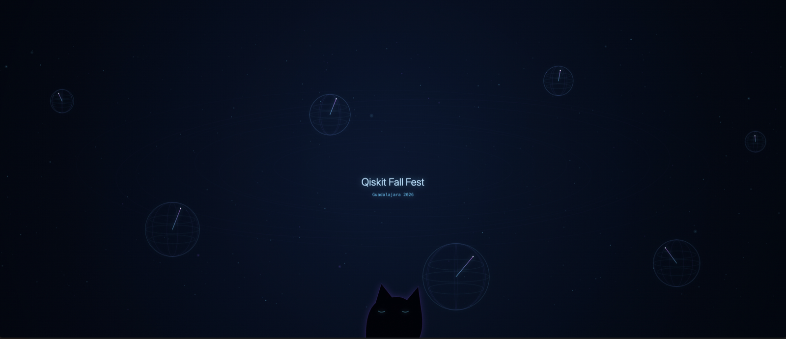

# Quantum Cat Journey

Experiencia audiovisual generativa para una instalación de múltiples pantallas. Un campo cuántico científico permanece como protagonista mientras un gato astronauta aparece gradualmente como un easter egg integrado en el sistema.

La animación utiliza Canvas 2D, módulos JavaScript nativos y el reloj del sistema. No requiere librerías, cuentas ni servicios externos.

Publicación: [animación](https://quantum-guild-gdl.github.io/quantum-immersive-animation/) · [vista previa de las 10 pantallas](https://quantum-guild-gdl.github.io/quantum-immersive-animation/preview.html).

## Experiencia

El loop dura 112 segundos e incluye:

1. Campo cuántico ambiental sin gato.
2. Una cola casi imperceptible en el borde.
3. Cruce del gato con movimiento de gravedad cero.
4. Reacción sutil de una esfera de Bloch.
5. Superposición del gato durante 1.35 segundos.
6. Huellas formadas por partículas.
7. Encuentro breve con una calabaza cuántica.
8. Falso final, un gato asomándose y el logo de Qiskit Fall Fest Guadalajara 2026 en cada una de las 10 pantallas.

## Ejecutar

Requiere Node.js 18 o posterior. No hay dependencias que instalar.

```bash
npm run dev
```

Abre `http://localhost:8080`.

Para revisar la instalación de 10 pantallas en HTML, abre `http://localhost:8080/preview.html`. La vista previa conserva las proporciones reales, muestra los límites de cada pantalla y permite seleccionar una salida individual.

El botón **Ver gatos y logos** reproduce la aparición final en las 10 pantallas para revisarla sin esperar el bucle completo.

El botón **Ver QR y videos** muestra un turno de recursos. Cada pantalla mantiene una composición propia con nebulosas, estrellas, circuitos y una estructura cuántica animada de gran tamaño. Cinco pantallas por turno muestran los QR de Discord y check-in, un logo de Qiskit o IBM Quantum y el mismo video simultáneamente en dos pantallas. Las dos copias comparten la reproducción en el panorama; las salidas individuales siguen el reloj común. Las posiciones y el orden de los videos cambian en cada ciclo; el resto conserva la animación. No se muestra agenda. La cantidad de pantallas con video se controla con `videoScreenCount` en `src/config/resource-config.js`.

Los recursos proceden de la [página de fondos del festival](https://quantum-guild-gdl.github.io/qiskit_fall_fest_gdl/background/). Los QR se guardan localmente sin modificar y permanecen quietos sobre fondo blanco. Las dos películas verticales de IBM tienen copias optimizadas a 1080 × 1920, sin alterar los originales de Descargas. Cada video ocupa toda su pantalla de borde a borde, sin márgenes, encabezado ni pie de texto, conservando la proporción 9:16. Se reproducen silenciados, acompañados por la música ambiental. Los videos, QR y logos funcionan sin conexión. La configuración está en `src/config/resource-config.js`.

En macOS también puedes hacer doble clic en `Iniciar Quantum Field.command`. Mantén abierta la ventana de Terminal durante la reproducción.

## Sonido espacial estéreo

Pulsa **Activar sonido espacial** en la vista previa o en la animación y ajusta **Volumen**. El navegador necesita ese primer clic para habilitar el audio. Funciona con audífonos o dos bocinas conectadas a la salida estéreo del equipo.

El ambiente se genera con Web Audio, sin descargas ni servicios externos: acordes suaves que cambian lentamente, una melodía espaciada de campanas y ecos estéreo de izquierda a derecha. La mezcla usa notas afinadas, sin la textura de viento ni el zumbido grave. Un tono sigue la posición del gato a través del lienzo; la superposición y el final tienen sus propias capas sonoras. El audio sigue el reloj de la animación, se silencia al pausar en depuración y baja durante el falso final.

La vista previa mantiene una sola mezcla al cambiar de pantalla. Para la instalación, activa el sonido únicamente en el equipo que alimente las bocinas. Los controles de la animación se ocultan en pantalla completa; sal de ella para ajustar el audio. La exportación MP4 actual contiene solo video; el sonido se reproduce en HTML.

## Exportar a MP4

La exportación requiere FFmpeg y las dependencias de desarrollo:

```bash
brew install ffmpeg
npm install
npm run export:mp4
```

El archivo resultante se guarda en `exports/quantum-cat-journey-10800x1920.mp4` con resolución `10800 × 1920 px`, 40 FPS y códec HEVC/H.265. La resolución y el nombre se calculan a partir de la configuración de pantallas.

La reproducción de los dos videos de IBM está disponible en HTML. La exportación por Canvas conserva sus imágenes de portada como referencia estática; los videos no se incrustan en el MP4 exportado.

## Pantalla completa

- Presiona `F` o haz doble clic sobre la animación.
- El cursor permanece oculto para que la salida no parezca una página web.

## Configurar las pantallas

Edita [`src/config/screen-config.js`](src/config/screen-config.js). El motor no presupone una cantidad, resolución o distribución específica. Cada región contiene:

```js
{
  id: "SCREEN_1",
  width: 1080,
  height: 1920,
  x: 0,
  y: 0,
  orientation: 0,
  transitionDelay: 0.18
}
```

Las 10 regiones de `1080 × 1920 px` forman un lienzo virtual total de `10800 × 1920 px`.

- `x`, `y`: posición dentro del lienzo virtual.
- `width`, `height`: resolución lógica de la región.
- `orientation`: `0`, `90`, `180` o `270` grados.
- `transitionDelay`: pausa en segundos antes de entrar a la siguiente pantalla.

La vista sin parámetros muestra el lienzo virtual completo. Para una salida individual usa el ID o el número:

```text
http://localhost:8080/?screen=SCREEN_1
http://localhost:8080/?screen=1
http://localhost:8080/?screen=10
```

## Línea de tiempo

Las escenas y sus tiempos están en [`src/config/timeline-config.js`](src/config/timeline-config.js). El movimiento del gato se implementa como un componente reutilizable en [`src/components/cat-component.js`](src/components/cat-component.js).

## Rendimiento

La experiencia limita la densidad de píxeles y se estabiliza en 40 FPS. Si el costo de un cuadro aumenta, reduce progresivamente partículas y segmentos orbitales antes de perder fluidez. Los límites se pueden ajustar en [`src/config/scene-config.js`](src/config/scene-config.js):

```js
performance: {
  targetFps: 40,
  dprCap: 1.25,
  minimumQuality: 0.55,
  qualityStep: 0.1
}
```

## Modo de depuración

Cambia una sola propiedad en [`src/config/screen-config.js`](src/config/screen-config.js):

```js
debugMode: true
```

El modo de depuración muestra límites del lienzo, regiones físicas, IDs, trayectoria y tiempo. Con el modo activo:

- `Espacio`: pausa o continúa.
- Teclas `0`–`9`: saltan a intervalos de diez segundos.
- `?time=48.7`: congela un instante específico para revisión visual.

Para producción, conserva `debugMode: false`.

## Estructura

```text
assets/                   Imágenes y referencias
src/config/               Pantallas, escenas y tiempos
src/core/                 Mapeo, reloj y utilidades
src/components/           Entorno, gato, efectos y depuración
scripts/dev-server.mjs    Servidor local sin dependencias
```

## Referencias visuales

### Quantum Cat Journey



El razonamiento visual y técnico previo a la implementación está documentado en [`docs/IMPLEMENTATION_PLAN.md`](docs/IMPLEMENTATION_PLAN.md).
