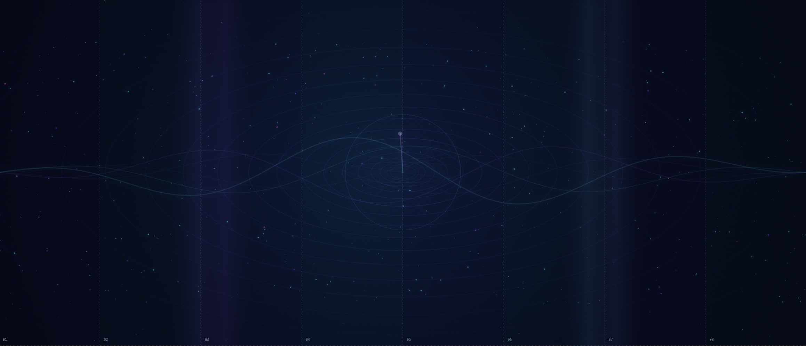
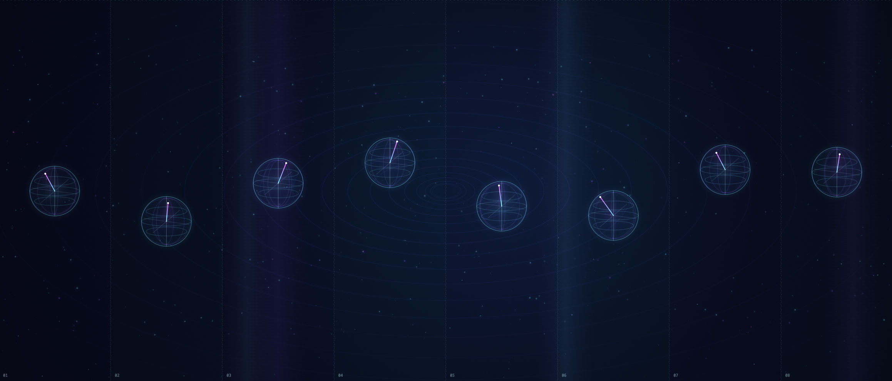

# Quantum Cat Journey

Experiencia audiovisual generativa para una instalación de múltiples pantallas. Un campo cuántico científico permanece como protagonista mientras un gato astronauta aparece gradualmente como un easter egg integrado en el sistema.

La animación utiliza Canvas 2D, módulos JavaScript nativos y el reloj del sistema. No requiere librerías, cuentas ni servicios externos.

## Experiencia

El loop dura 112 segundos e incluye:

1. Campo cuántico ambiental sin gato.
2. Una cola casi imperceptible en el borde.
3. Cruce del gato con movimiento de gravedad cero.
4. Reacción sutil de una esfera de Bloch.
5. Superposición del gato durante 1.35 segundos.
6. Huellas formadas por partículas.
7. Encuentro breve con una calabaza cuántica.
8. Falso final, aparición de ojos y cierre de Qiskit Fall Fest Guadalajara 2026.

## Ejecutar

Requiere Node.js 18 o posterior. No hay dependencias que instalar.

```bash
npm run dev
```

Abre `http://localhost:8080`.

En macOS también puedes hacer doble clic en `Iniciar Quantum Field.command`. Mantén abierta la ventana de Terminal durante la reproducción.

## Pantalla completa

- Presiona `F` o haz doble clic sobre la animación.
- El cursor permanece oculto para que la salida no parezca una página web.

## Configurar las pantallas

Edita [`src/config/screen-config.js`](src/config/screen-config.js). El motor no presupone una cantidad, resolución o distribución específica. Cada región contiene:

```js
{
  id: "SCREEN_1",
  width: 320,
  height: 1080,
  x: 0,
  y: 0,
  orientation: 0,
  transitionDelay: 0.18
}
```

- `x`, `y`: posición dentro del lienzo virtual.
- `width`, `height`: resolución lógica de la región.
- `orientation`: `0`, `90`, `180` o `270` grados.
- `transitionDelay`: pausa en segundos antes de entrar a la siguiente pantalla.

La vista sin parámetros muestra el lienzo virtual completo. Para una salida individual usa el ID o el número:

```text
http://localhost:8080/?screen=SCREEN_1
http://localhost:8080/?screen=1
```

## Línea de tiempo

Las escenas y sus tiempos están en [`src/config/timeline-config.js`](src/config/timeline-config.js). El movimiento del gato se implementa como un componente reutilizable en [`src/components/cat-component.js`](src/components/cat-component.js).

## Rendimiento

La experiencia limita la densidad de píxeles y se estabiliza en 40 FPS. Si el costo de un cuadro aumenta, reduce progresivamente partículas y segmentos orbitales antes de perder fluidez. Los límites se pueden ajustar en [`src/config/scene-config.js`](src/config/scene-config.js):

```js
performance: {
  targetFps: 40,
  dprCap: 1.25,
  minimumQuality: 0.55,
  qualityStep: 0.1
}
```

## Modo de depuración

Cambia una sola propiedad en [`src/config/screen-config.js`](src/config/screen-config.js):

```js
debugMode: true
```

El modo de depuración muestra límites del lienzo, regiones físicas, IDs, trayectoria y tiempo. Con el modo activo:

- `Espacio`: pausa o continúa.
- Teclas `0`–`9`: saltan a intervalos de diez segundos.
- `?time=48.7`: congela un instante específico para revisión visual.

Para producción, conserva `debugMode: false`.

## Estructura

```text
assets/                   Imágenes y referencias
src/config/               Pantallas, escenas y tiempos
src/core/                 Mapeo, reloj y utilidades
src/components/           Entorno, gato, efectos y depuración
scripts/dev-server.mjs    Servidor local sin dependencias
```

## Referencias visuales





El razonamiento visual y técnico previo a la implementación está documentado en [`docs/IMPLEMENTATION_PLAN.md`](docs/IMPLEMENTATION_PLAN.md).
